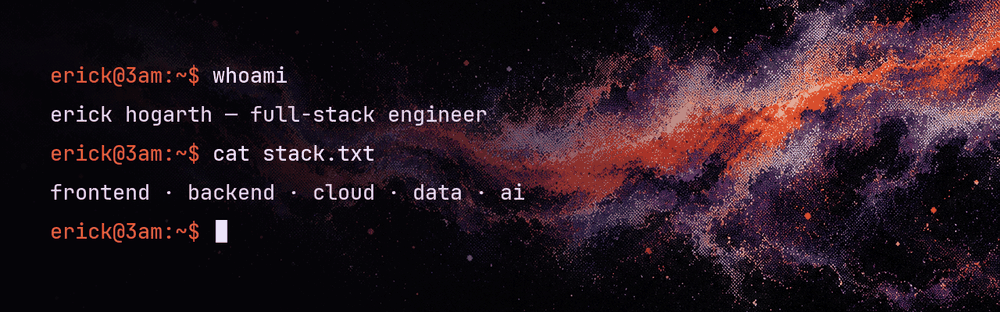

  

<h3 align="center">i build the whole thing.</h3>

  the interface you click · the api behind it · the database under it 
  the cloud it runs on · the ai agents that help ship it

  
    
    

<i>best commits happen after the sun goes dark.</i>

  
  
  

